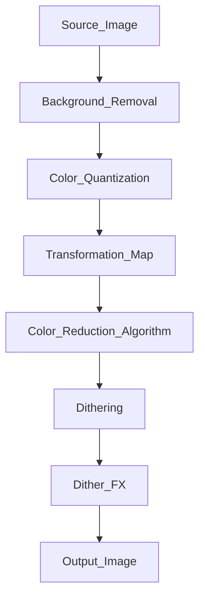

# ColourClashNet - Work in progress
A .NET 10 toolkit to convert modern images into pictures displayable by retro computers and consoles,
using color quantization, palette reduction, hardware specific video mode emulation and dithering.


## Purposes
These tools can be used to create displayable images for old computer video modes, using various color reduction algorithms, color quantization, and dithering.
They can also extract sprites and tiles (blobs) from sprite sheets.

## Reduction recipe
To reduce colors on source images for old systems' video mode we need to know:
- The output computer color space, aka the number of bits the system uses to represent a color.
Source image usually has 3 color channels (red, green, and blue) with 8-bit per channel, for a total of 16 million selectable colors.
Old systems usually have 3 channels with 3 or 4-bit for color, for a total of 512 or 4096 selectable colors, or even a fixed color palette.
- The maximum number of colors displayable on video modes. Most computers can display only 16 colors on screen.
- The hardware limitations. Most computers use tricks to minimize ram consumption, like using tiles (attribute cells), doubling pixels or changing the palette on every scanline.

## Solution structure
| Project | Target | Content |
|-|-|-|
| `ColourClashLib` | net10.0 | Core library: packed colors, color spaces (RGB, HSV, LAB, GRAY), palettes, histograms, quantization, color transformations, dithering, tiles, image load/save (SkiaSharp), indexed BMP and Amiga bitplane export |
| `ColourClashProcessing` | net10.0 | Image processing: global color threshold, run length extraction, blob (connected component) detection and sprite export |
| `ColourClashSupport` | net10.0 | Logging facade (`LogMan`) over NLog, Trace and a UI event |
| `ColourClashDrawings` | net10.0-windows | WinForms components: zoomable bitmap renderer, coordinate and mouse managers, processing pipeline manager, `ColorAnalyzer` control, GDI+ conversions |
| `ColourClashNet` | net10.0-windows | Main WinForms application (one `ColorAnalyzer` per tab) |
| `ModuleTester` | net10.0-windows | Manual test bench for every transformation |
| `ColourClash` | net10.0 | Command line front-end (work in progress) |
| `XUnitTester` | net10.0-windows | xUnit v3 tests |

## How to
Create a color transformation, configure it with its options record, feed it with an input image
and get the transformed image.

```csharp
using ColourClashNet.Color;
using ColourClashNet.Color.Dithering;
using ColourClashNet.Color.Transformation;
using ColourClashNet.Imaging;

var source = ImageTools.LoadImage("input.png");

var transform = new ColorTransformClustering
{
    Options = new ClusteringOptions
    {
        MaxColors = 16,
        TrainingLoops = 10,
        Selection = ColorSelectionMode.EvaluateColorMean,
        DistanceMode = ColorDistanceEvaluationMode.RGB,
        Dithering = new DitherOptions { DitheringType = ColorDithering.FloydSteinberg },
    },
};

var result = transform.Process(source);            // or await transform.ProcessAsync(source)
if (result.IsSuccess)
{
    ImageTools.SaveImage(result.DataOut, "output.png", ImageSaveFormat.Png);
    Console.WriteLine($"{result.TransformationError:g4} in {result.ProcessingTimeMilliseconds:f0} ms");
}
else
{
    Console.WriteLine(result.Message);   // "Class.Method : what failed : nested cause"
}
```

`Process(source, reference, token)` is the single entry point (`ProcessAsync` runs it on a worker thread):
it loads the images, validates the options, transforms, dithers and evaluates the error.
Errors and cancellation are returned in the result, never thrown.
The options record also selects the algorithm: `ColorTransformBase.CreateTransform(options)`
creates the matching `IColorTransform` (`CreateTransform(ColorTransformType)` uses the default options).

Events of a run, in order:

| Event | When | Typical use |
|-|-|-|
| `StartProcessing` | first, before anything is done | change the options with `SetOptions`, or cancel the run |
| `Creating`, `Created` | around the loading of the images | reserved for future use |
| `Processing` | options valid, transformation starting | show a progress window |
| `Progress` | any number of times, also from nested transformations and tiles | progress percentage and intermediate images |
| `Dithering` | before the final dithering (only when it is applied) | inspect the undithered image |
| `Completed` | always last, also on error or cancellation | final result |

`Destroying` and `Destroyed` are raised by `Dispose()` (reserved for future use).
Every event carries a `CancellationTokenSource` linked to the run: cancelling it stops the processing.

A transformation instance is not thread safe: it processes one image at a time.
Run concurrent work on separate instances (the UI pipeline, the tiles and the nested steps always create their own).

### Options
Every transformation is configured by an immutable `record` derived from `TransformOptions`:

- **Common settings** (`TransformOptions`): `DistanceMode`, `Dithering` (`DitherOptions`) and `UserPalette`
  (colors chosen by the user: kept by the fast and clustering reductions, used as target palette by the fixed palette mappings).
- **Specific settings**, one record per transformation: `ClusteringOptions`, `MedianCutOptions`, `FastOptions`,
  `QuantizationOptions`, `HsvOptions`, `ScanlineOptions`, `CgaOptions`, `VgaOptions`, `C64Options`,
  `AmigaOptions`, `CpcOptions`, `ZxOptions`, ...
- **Nested steps** are options too: e.g. `ScanlineOptions.ChunkReduction`, `VgaOptions.Reduction` and
  `AmigaOptions.BasePaletteReduction` accept any `ColorReductionOptions` (fast, median cut or clustering).
- **Hardware palettes** (CGA, EGA, CPC, C64, ZX ...) belong to the transformation and are never stored in the options.

Change a value with a `with` expression; the same instance can be shared freely:
```csharp
transform.Options = transform.Options with { MaxColors = 8 };
```

Options are validated when processing starts (`Validate()`): invalid values produce an error result
instead of an exception. Presets can be saved and loaded as JSON with `TransformOptionsSerializer`:
```csharp
TransformOptionsSerializer.Save(transform.Options, "c64-multicolor.json");
var preset = TransformOptionsSerializer.Load("c64-multicolor.json");
var transform2 = ColorTransformBase.CreateColorTransformInterface(preset);
```

The UI pipeline (background removal, quantization, transformation) is described by `PipelineOptions`.

### Processing



Each `ColorTransformBase` runs the same pipeline in `Process`:
1. load the source and reference images;
2. validate the options (invalid options give an error result listing every problem);
3. `ExecuteTransform`: the single hook of the derived classes, produces the reduced image;
4. dithering against the reference image, when enabled and the result has at most 256 colors;
5. evaluation of the mean color error (`TransformationError`, also in the result with the processing time).

Transformations based on a color map (fast, median cut, clustering, quantization, palette mappings, background removal)
derive from `ColorTransformMapBase<TOptions>` and only implement `CreateTransformationMap`.
`Type` always comes from the options (`TransformOptions.TransformType`).

A transformation can skip step 4 by setting `BypassDithering` inside `ExecuteTransform`
(the flag is reset at every run), when it dithers by itself or when dithering does not apply in its current mode:
for example the wide pixel modes (CPC modes 0/3, C64 multicolor, CGA composite) dither at half horizontal resolution,
before doubling the pixels back.

### Color representation
Colors are stored as packed `int` values: the lower 24 bits hold the RGB888 color (`0xRRGGBB`),
the upper 8 bits hold a `ColorInfo` flag (mask, tile, transparent, invalid).
Every value that is not a real color is negative, so `value < 0` filters it out quickly.

## Limitations
Processing algorithms don't support alpha channels: the alpha channel is discarded when an image is loaded,
and odd widths are padded to an even number of columns.

## To do
A lot of stuff, like sprite masking, raw data export for every system and assembly code generation.


## Support
### Quantization
Quantization reduces the number of bits for colors channel. The lower value, the less shadow of colors.
|Quantization Level|Red Shades|Green Shades|Blue Shades|Total selectable colors| Notes |
|-:|-|-|-|-|-|
| 8-8-8 | 256 | 256 | 256 | 16,777,216 | 24 bit images, SVGA, Amiga AGA |
| 6-6-6 | 64  | 64  | 64  | 262,144 | Amiga HAM8, VGA |
| 5-6-5 | 32 | 64 | 32 | 65536 | 16 Bit Hi Color |
| 5-5-5 | 32 | 32 | 32 | 32768 | 15 Bit Hi Color, SNES |
| 4-4-4 | 16 | 16 | 16 | 4096 | Amiga OCS/ECS/HAM6, Atari STE, NeoGeo |
| 3-3-3 | 8 | 8 | 8 |  512 | Atari ST, Sega Genesis, PC Engine |
| 2-2-2 | 4 | 4 | 4 |  64 | EGA |
| 1-1-1 | 2 | 2 | 2 |  8  | Basic Color Schemes |

To generate an image for Sega Genesis, the proper 3-3-3 color quantization should be selected before processing image.
Quantized channels replicate their high bits into the low bits, so the full intensity range is preserved (e.g. 4 bit `0xF` becomes `0xFF`).

| Original Image (22000 colors) | 5-6-5 Quantization | 4-4-4 Quantization | 3-3-3 Quantization | 1-1-1 Quantization |
|-:|-|-|-|-|
||||||

### Color distance
The metric used to find the nearest palette color is selectable (`ColorDistanceEvaluationMode`):
`RGB` (squared Euclidean), `RGBalt` (RGB with cross-channel terms that penalize hue shifts),
`HSV` (circular hue distance), `LAB` (CIE76 ΔE) and `GRAY`.

### Dithering
Dithering spreads the color reduction approximation errors over the entire image. After the color reduction process, dither tries to simulate the missing color using the remaining color information. Dithering strength can be adjusted to obtain better results.

| Family | Algorithms |
|-|-|
| Ordered (Bayer) | 2x2, 4x4, 6x6, 8x8 |
| Error diffusion | Floyd-Steinberg, Atkinson, Burkes, Jarvis-Judice-Ninke, Sierra, Stucki, ScanLine (current line only) |

A post-dithering effect (`ColorDitheringFx`) can restore every other row or column from the undithered image,
producing a scanline-like blend between the dithered and the plain result.

| 16 Color Image Without Dithering | 2x2 Ordered Dithering | 4x4 Ordered Dithering | Floyd Steinberg Dithering | Jarvis, Judice and Ninke Dithering |
|-:|-|-|-|-|
||||||

### Color Reduction
There are lots of classic color reduction algorithms. The majority simply reduce the number of colors, while others try also to adapt the source image according to the system screen mode limitations.

| Transformation | Class | Description |
|-|-|-|
| Quantization | `ColorTransformQuantization` | Channel bit-depth reduction |
| Fast | `ColorTransformFast` | Keeps the most frequent colors |
| Median cut | `ColorTransformMedianCut` | Recursive split along the widest channel |
| Clustering | `ColorTransformClustering` | K-means with reseeding of empty clusters; fixed reference colors never move |
| Fixed palette | `ColorTransformFixedPalette` | Nearest color of a user palette |
| Enhanced palette | `ColorTransformFixedPaletteEnhanced` | Fixed palette plus the mean of every color pair (simulated 50% dither) |
| Scanline | `ColorTransformScanLine` | Palette per group of lines (Amiga copper style), independent or shared palette |
| HSV adjust | `ColorTransformLumSat` | Hue rotation (any value, wrapped on the color wheel), saturation and brightness multipliers; non-color pixels are kept |
| Background removal | `ColorTransformBkgRemover` | Replaces selected background colors |
| IBM PC | `ColorTransformHercules`, `ColorTransformCGA`, `ColorTransformEGA`, `ColorTransformVGA` | Hercules, CGA modes 4/5/6 and composite artifact colors, EGA 16 colors, VGA 256 colors (RGB666) |
| Commodore 64 | `ColorTransformCbm64` | Hires, Multicolor, FLI, Hires FLI, base and enhanced palette |
| Commodore Amiga | `ColorTransformCbmAmiga` | HAM6, HAM8 (each pixel choice scored on the next `HamLookahead` pixels to reduce fringes), Extra Half-Brite |
| Amstrad CPC | `ColorTransformAmstradCPC` | Modes 0, 1, 2 and 3 on the 27 color palette |
| ZX Spectrum | `ColorTransformZxSpectrum` | 8x8 attribute cells, normal/bright palettes, automatic seed tuning |

Tile based modes (C64, ZX Spectrum, scanline) use `TileManager`, which splits the image into cells and color-reduces each one independently.

Notes on some modes:
- **CGA composite** (`Composite_0`, `Composite_1`): every pair of adjacent pixels of mode 4 is seen on an NTSC monitor
  as one of 16 artifact colors. The image is halved horizontally, mapped and dithered, then doubled back.
  With `CgaOptions.OutputMode = RawImage` each artifact color is replaced by the two mode 4 pixels that generate it
  (left pixel in the high bits, high intensity palettes); the palette modes output the processed image unchanged.
  The true 16 color RGBI palette is available as `DebugPalette`.
- **Amiga HAM**: each pixel is a base palette color or the previous pixel with one channel modified.
  Choosing by the error of the current pixel only produces color fringes, so every choice is scored on the
  current pixel plus the next `AmigaOptions.HamLookahead` pixels (default 2, range 0-4; 0 = previous greedy behavior).
- **Wide pixel modes** keep odd image widths: the doubled image is cropped back to the source width.

| | | |
|-:|-|-|
|Original Image (22000 colors)|||
||||
|SVGA 256 Colors|VGA 256 Colors| EGA 16 Colors|
||||
|AMIGA HAM8 Mode | AMIGA HAM6 Mode| AMIGA OCS 16 Colors with Copper |
||||
|ATARI STE 16 Colors | ATARI ST 16 Colors||
||||
|Commodore 64 HiRes Mode|Commodore 64 LoRes Mode||
||||
|Zx Spectrum|Zx Spectrum Alternative||
||||
|Amstrad CPC Mode0|Amstrad CPC Mode1|Amstrad CPC Mode2|
||||

### Blob extraction
`ColourClashProcessing.Blob.Blob` extracts sprites from a sprite sheet:
1. a global threshold separates foreground from the selected background colors (with tolerance and optional inversion);
2. foreground pixels are converted into horizontal run lengths;
3. runs are grouped into blobs by run based connected component labeling (union-find, 4 or 8 connectivity);
4. blobs are filtered by size.

Each blob can be cut from the source image with a cookie-cut mask, exported as a separate image (`BlobTools.ExportImages`)
or stacked into a single image (`BlobTools.ReshapeVertical`).

The detector is configured, like the transformations, with immutable records:
```csharp
var blob = new Blob
{
    Options = new BlobOptions
    {
        Threshold = new ThresholdOptions { BackgroundColors = new[] { 0xFF00FF }, Tolerance = 0 },
        ConnectionMode = BlobConnectionModes.EightConnected,
        MinArea = 10,          // size limits set to 0 are disabled
    },
};
var result = blob.Process(spriteSheet);
blob.Options = blob.Options with { MinArea = 20 };
```

### Export
- PNG, BMP and JPG through SkiaSharp (`ImageTools.SaveImage`);
- 8 bit indexed BMP with optional width alignment (`ImageTools.SaveImageAsIndexedBitmap`);
- Amiga raw bitplanes, interleaved or sequential (`.bpl`), with palettes in 24 bit (`.rgb24`) and OCS 12 bit (`.rgb12`) format (`ImageTools.BitplaneWriteFile`).

### Logging
`LogMan` (project `ColourClashSupport`) writes every message to `System.Diagnostics.Trace`, to a rolling NLog file
(`./Logs/Log.txt`, archived above 4 MB in `./Logs/LogsArchive`) and to the `LogMan.OnLogMessage` event, used by the UI.
Each line reports time, level and `Class.Method`:
```
2026-11-21 22:30:24.218 | Debug | ColorTransformBase.Process : ColorReductionClustering : processing completed in 243 ms : 16 colors, error 7504
```

| Level | Content |
|-|-|
| `Fatal`, `Exception`, `Error` | Failures, with the nested cause and the exception dump |
| `Warning` | Handled conditions, e.g. cancelled operations |
| `Message` | Main UI operations: transformation started/completed, blobs found |
| `Debug` | Start of every heavy step with its parameters, completion with time, colors and error, file load/save |
| `Trace` | Sub-steps: full options, clustering loops, ZX autotune steps, tile summaries |

`LogMan.MinLogLevel` selects the minimum level and can be changed at any time (the applications start at `Message`).
Use `LogMan.IsDebugEnabled`/`IsTraceEnabled` to skip building expensive messages.
Transformations log nothing inside pixel loops, and the transformations of the tiles do not log their steps
(`ColorTransformBase.LogProcessingSteps`): errors and exceptions are always logged.

## Build and test
```bash
dotnet build ColourClashNetSolution.sln
```

The WinForms projects target Windows; on other systems the solution builds with `-p:EnableWindowsTargeting=true`,
but the UI and the `XUnitTester` project run on Windows only.

The tests do not need external files. Reference pictures made on the real systems, useful to compare the results,
are in `Images/References/TestImages` (Amstrad CPC modes 0/1/2, CGA, C64 hires/multicolor/FLI/PETSCII,
Amiga EHB/HAM6/HAM8, ZX Spectrum).

## Coding conventions
- Local variables, parameters and fields are camelCase and carry only the name, without type prefixes (`val`, not `sVal`).
- Properties are PascalCase.
- Every class keeps `sC`/`sClass` (from `nameof(Class)`) and every method `sM`/`sMethod` (from `nameof(Method)`) for logging with `LogMan`.
- Log messages are in English and start with the transformation type when available (`{Type} : ...`); no logs inside pixel loops.
- Code, comments and documentation are in English; public types and members are documented with XML comments.

## License
MIT, see [LICENSE.txt](./LICENSE.txt).
